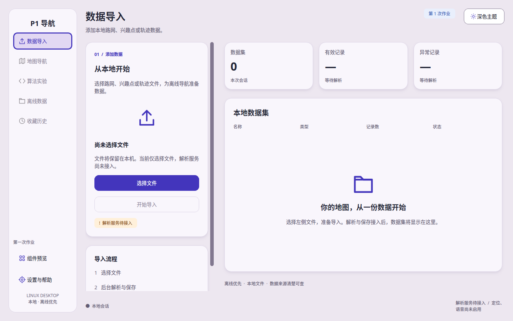

# 第一次作业：1 号应用框架与公共组件

负责人：1。目标环境与版本见 [统一开发环境](development-environment.md)，视觉基准见 [design.md](../design.md)。本模块负责应用窗口、导航、主题、公共组件和模块页面装配。真实文件解析、保存与业务导入页面由 2 号接入。

## 当前能力

- C++17 / Qt 6.4.2 Widgets / CMake 工程，应用目标 `p1-navigation`，公共 UI 目标 `p1_ui`。
- Linux 原生窗口标题栏；优先 1440×900，较小桌面按可用屏幕限制尺寸并由 compositor 最大化；宽屏侧栏与 1024 逻辑像素紧凑侧栏；页面使用 `QStackedWidget`，页面切换保留控件状态。
- 按 design.md 实现浅色/深色主题、语义颜色、统一字体层级、圆角与卡片阴影。主题作用于现有控件，不销毁或重建页面。
- 文件选择入口与空态，仅记录已选择文件的路径、名称和大小；不读取内容、不解析、不保存、不伪造成功或进度。
- 组件演示页：列表、卡片、表单、手动进度、不定进度、禁用状态、确认/取消对话框。
- 设置/帮助、主题双入口、会话内偏好，后续功能入口禁用。定位、语音、地图与算法尚未接入。

## 代码结构与所有权

| 文件 | 职责与关键函数 |
| --- | --- |
| `CMakeLists.txt` | Qt 精确版本与 C++17、公共库/应用/测试目标，安装程序 |
| `src/app/main.cpp` | QApplication 生命周期、启动参数、smoke 与截图入口 |
| `src/app/MainWindow.*` | 页面注册、主布局、断点、导航及组件/设置页面 |
| `src/app/ImportLanding.*` | 应用级导入占位页、系统文件对话框及所选文件元信息 |
| `src/ui/common/Theme.*` | `Theme::apply()` 设置调色板/QSS；`setDark()` 更新已有页面并发出信号；自绘线性图标 |
| `src/ui/common/Components.*` | 通用标题/标签/按钮、可滚动容器、Card 与主题联动阴影 |
| `tests/UiTests.cpp` | Qt Test 交互与模块页面替换验证 |
| `tools/verify-environment.sh` | Ubuntu/架构/Qt/GCC/G++/CMake 基线核对，版本不符返回失败 |

Theme 在 main 中先于 MainWindow 创建，后于窗口销毁；窗口和页面由 Qt 父子关系拥有。页面替换先从堆栈移除旧页，再 `deleteLater()`，避免在事件处理过程中立即销毁控件。公共组件信号连接指定接收者，页面销毁后自动断开。所有页面注册和 UI 更新必须发生于 GUI 线程。

`setCurrentPage()` 只接受已注册页面，不会切入不存在或尚未接入的功能。`registerPage()` 成功后由窗口取得页面所有权；失败时调用方仍拥有该页面。当前页面被替换时维持导航 ID，更新标题与实际显示控件；后续功能页面一旦注册，对应入口自动启用。

## Linux 构建与运行

在统一 Ubuntu 虚拟机内，从工程根目录执行（源码通过 Git 获取或本机文件交换均可，构建目录必须位于 Linux 文件系统）：

```bash
bash tools/verify-environment.sh
cmake -S . -B build -G Ninja \
  -DCMAKE_BUILD_TYPE=Debug \
  -DCMAKE_CXX_COMPILER=/usr/bin/g++-13
cmake --build build -j1
ctest --test-dir build --output-on-failure
./build/p1-navigation
```

虚拟机当前基线为 1 vCPU，故构建使用 `-j1`。Qt Creator 选择既有 P1 Linux Kit，打开根目录 `CMakeLists.txt`；不要选用 Windows Kit。仅运行应用时所需 Qt Widgets 运行库、平台插件及字体由目标 Ubuntu 系统提供；当前没有制作包含全部运行依赖的跨发行版安装包。

无显示服务的验证与截图命令：

```bash
QT_QPA_PLATFORM=offscreen ./build/p1-navigation --smoke
QT_QPA_PLATFORM=offscreen ./build/p1-navigation --capture-dir out/ui-review
```

`--capture-dir` 依次保存浅色导入、浅色组件、深色导入和紧凑布局，并退出；截图来自真实 Qt 控件渲染。offscreen 图像只能证明布局/控件渲染，不能作为实际 Wayland 桌面、原生文件对话框或硬件性能验收。正常桌面启动时不要设置 offscreen 环境变量。

安装到单独目录：

```bash
cmake --install build --prefix "$PWD/out/app"
./out/app/bin/p1-navigation
```

## 2/3/4/5 号页面交接

接入使用已有窗口的注册方法；以下为调用示例，`createImportPage` 是 2 号将来提供的工厂占位名称，当前未实现：

```cpp
auto* importPage = createImportPage(repository, &window);
if (!window.registerPage("import", "数据导入", "添加本地数据", importPage)) {
    importPage->deleteLater();
}
```

可用页面 ID：`import`、`map`、`algorithms`、`offline`、`history`、`components`、`settings`。主窗口与顶层目标由 1 号装配；模块通过自己的 CMake 目标提供 QWidget 工厂，不由窗口直接读取数据库或实现算法。各模块复用 `p1::ui::Card`、`label()`、`button()` 和应用主题。

目前只提供页面装配接口，不把草案中的 DataRepository 或导入格式写死。接入真实解析前由 2 号按 X01 确认方案、格式、进度/取消/结果和所有权契约；未确认时不启用“开始导入”。持久化偏好通过 2 号 StorageAdapter，尚未接入前重启恢复浅色默认值。

## 验证范围与待办

自动检查覆盖：初始窗口适配可用屏幕、主题切换/导航保持表单与进度、禁用入口、文件选择后的状态保持与无效路径、页面替换所有权、紧凑窗口中的文件按钮可达、演示对话框 Esc 关闭。文件选择测试使用临时文件，内容不参与解析。

真实 Wayland 桌面已检查应用与主题、初始窗口适配、组件页面、演示对话框打开、Qt 文件选择框及元信息回传；`fc-match` 确认 Noto Sans CJK SC Regular 可用。各页面完整人工 Tab 顺序、高 DPI 与 200% 字号、GNOME portal 选择器及其他成员复现仍待检查。当前无业务异步解析任务，因此没有将手动演示进度当作异步解析验收。

本轮构建环境曾出现现有虚拟机根文件系统 `emergency_ro` 与 `Input/output error`，用户已选择保留故障虚拟机、使用基础快照独立克隆进行验证。克隆中版本核对、CMake 构建、offscreen 与真实 Wayland Qt Test（各 8 通过、0 失败）、offscreen 截图、安装后启动及运行依赖检查通过；常规原生桌面基础检查也已补齐，完整缩放/键盘验收仍待进行。原始报告、桌面与 offscreen 图像、最新包校验值和限制见 [本轮验证记录](verification/assignment1/README.md)。


